# Itinerary – User Manual

Itinerary guides you through leveling one step at a time: what to do now, where to go, and what to keep
doing on the way. It also takes care of the busywork in between: quests, dialogue, junk, trainers,
professions and flights.

**Contents**
1. [Getting started](#1-getting-started)
2. [The route panel](#2-the-route-panel)
3. [The waypoint arrow](#3-the-waypoint-arrow)
4. [Item and target buttons](#4-item-and-target-buttons)
5. [Moving through the route](#5-moving-through-the-route)
6. [Trainers, weapon masters and professions](#6-trainers-weapon-masters-and-professions)
7. [Automation](#7-automation)
8. [Routes: choosing and sharing](#8-routes-choosing-and-sharing)
9. [The route editor](#9-the-route-editor) (and [recording a route](#recording-a-route))
10. [Settings](#10-settings)
11. [Commands](#11-commands)
12. [Troubleshooting](#12-troubleshooting)
13. [Credits and license](#13-credits-and-license)

---

## 1. Getting started

1. Put the `Itinerary` and `Itinerary_Data` folders (both come in the download) into the game's
   `Interface\AddOns` folder and start the game.
2. Log in. The **route panel** and the **waypoint arrow** appear.
3. A new character is asked once which **professions** it will take. Pick up to two main professions
   and any secondary ones (Cooking, First Aid, Fishing). You can change this later in the settings.
4. Itinerary picks the route made for your race and class. **Itinerary itself ships without routes.** If
   you have none yet, the panel says "No route loaded". Then:
   - **record your own** while you play (see [Recording](#recording-a-route)),
   - **import** a route someone shared with you (`/iti import`), or
   - install a **route pack**, a separate add-on folder next to Itinerary.
5. The **`Itinerary_Data`** folder that comes with Itinerary tells it where every class trainer,
   profession trainer, weapon master and tool vendor stands, so trainer instructions work from the start,
   and it holds the herb and ore spots for gather mode. It's optional: without it, Itinerary learns
   trainers and vendors as you meet them.

The **minimap button** (the brass compass):

| Click | Does |
|---|---|
| Click | Show or hide the route panel |
| Right-click | Show or hide the arrow |
| Shift + click | Open the settings |

Two things Itinerary changes in the game right away: the game's own **quest tracker** is hidden (the panel
tracks your objectives; Settings > General), and **quest sparkles** are on (quest objects on the ground and
NPCs with a quest for you sparkle, without the outlines around everything else; Settings > Quests). Both can be
switched back there.

---

## 2. The route panel

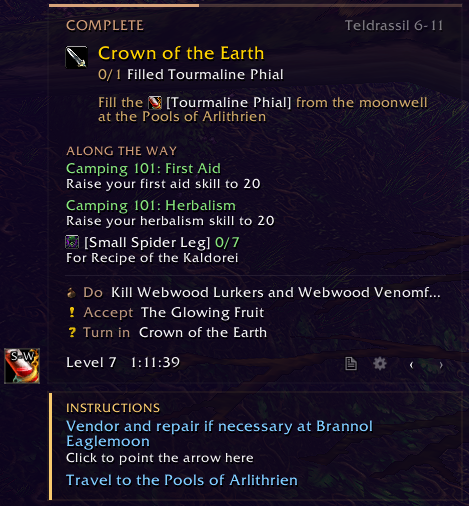

From top to bottom:

- **Header**: the step type (ACCEPT, COMPLETE, TURN IN, GO, FLY, TRAIN, …), the current chapter and the
  route's level range. A thin bar along the top shows how far through the chapter you are. Click the
  header to open the **chapter list** and jump to any chapter.
- **The step**: what to do now, with the NPC, quest names coloured by difficulty, and live objective
  counts (*Filled Tourmaline Phial 0/1*).
- **Hint**: a line under the step with extra advice (*Fill the Tourmaline Phial from the moonwell ...*). Items and
  spells in the text show their icon. Hover them for the tooltip; Shift-click links them in chat.
- **ALONG THE WAY**: side objectives you work on while you go, with live counts. These are quest
  objectives, side quests (*Camping 101: First Aid*) or items to collect (*Small Spider Leg 0/7*), one per
  line; items for a later quest say which one (*For Recipe of the Kaldorei*). Finished ones stay listed,
  greyed. Once the route reaches its own step for that quest, that step shows the counts instead.
- **Next steps**: a preview of what comes after. Steps that are done already are left out (a quest you
  have, an *Abandon* step for a quest you never took or handed in already).
- **Skipped quests** (*2 skipped quests still open · hover for the list*): quests you skipped that are still
  in your log, see [Skipping a quest](#5-moving-through-the-route).
- **Footer**:
  - **Level timer**: time on this level and your pace against the route's reference run. Hover it for
    every level's time; scroll on it for more.
  - **REC** (red, pulsing): you are recording a route. Click it to open the recorder.
  - **Route button** (note icon):
    - Click: the route list.
    - Right-click: the route editor.
    - Shift + right-click: the recorder.
  - **Gear**: the settings. Hover it to see how much memory Itinerary and your top 5 addons use
    (measured only while you hover).
  - **‹ ›**: one step back or forward.
- **INSTRUCTIONS**, in their own card under the panel (Settings > Panel > *Instructions*: *In the panel* puts
  them inside it): things to keep doing next to your step. Examples: sell junk, use your hearthstone,
  learn new skills at a trainer close by, a weapon master, a profession trainer, a place to head for.
  - The route's errands at a vendor are instructions too, not stops of their own: selling junk and repairs
    at a named vendor (*... at Brannol Eaglemoon*), food and water, bags. They're done when you open that vendor
    (selling junk: any vendor). So is every **optional buy**: a weapon "if you can afford it", items for a
    quest later, potions if they're in stock, and the auction house's "buy these for quicker turn-ins". Those
    are done once you have the items, or when you close that vendor or the auction house. Click one to point
    the arrow there. A buy the route needs (not optional) and a hunter's arrows stay a step.
  - **Click** an instruction that has a place (*Click to point the arrow here*), and the arrow points there.
    Click it again to go back to the route.
  - A timed quest's time left counts down on the instruction that runs until its turn-in (or on your step).
  - A "turn in / accept it if you pass by" that the route does as one of the next steps anyway isn't listed.

**A sound when a step is done**: Settings > General > *Sound when a step is done* plays one of nine sounds
(from a quest chime to a meow) when a step that takes a while is done: kill or loot objectives, collecting
items, grinding a level. Not for talking to NPCs, travelling or skipping. Off by default.

**Moving the panel**: Alt + right-click the panel to unlock it, drag it, then Alt + right-click again to
lock it.

**In dungeons**: Settings > General > *In dungeons* set to **Hide** puts the panel, the arrow and the item
buttons away while you're inside a dungeon or raid (off by default). The route goes on in the background,
and they're back when you leave. To see them inside anyway, click the minimap button (or `/iti`): that
shows them for this visit.

---

## 3. The waypoint arrow

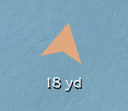

The arrow points at your step's target and shows the distance in yards. It follows the route's path
(into a cave, along a road). It skips waypoints you've already passed. For kill or collect steps it
points at the area where the mobs are.

- Above the arrow you see the current **instructions** in short form (you can turn this off, and set
  the font size). A **death skip** always shows there, also with the instructions turned off
  (Settings > Arrow > *Death skips at the arrow*, on).
  Trainer visits show there as one line, *Skills to learn nearby*: the arrow only leads to a trainer once you
  click its instruction in the panel.
- Hover the arrow for the step's details (Settings > Arrow > *Arrow tooltip*, on).
- **Alt + right-click** the arrow to unlock it, drag it, then Alt + right-click again to lock it.
- Arrow styles (Settings > Arrow):
  - **Itinerary**, **Gold**, **White**, **Big**
  - **Guide**: green when you're heading the right way, red when the target is behind you
  - **Classic**: the game's minimap arrow

**Map pins**: your next stops show as numbered pins in route order, on the world map (also on the
continent map) and on the minimap. Your current stop is in your theme colour. Steps at the same place
share one pin: *2-3* is a hand-in and the follow-up quest at the same NPC. On the world map a dotted line
runs from one stop to the next; the stretch to your next stop is the brighter one. On the minimap only the
first pin stays at the edge when it's far away; the others show once they're in range. Hover a pin for its
steps. Settings > Travel: *Map pins* (all of them, also `/iti pins`), how many on the world map and on the
minimap (Off, Current, Next 3, Next 5; default Next 5), and the line.

---

## 4. Item and target buttons

Next to the panel sit small action buttons. Each one can have a **key binding**: set them in
Settings > Keys, or in the game's key bindings under *Itinerary*. A button's tooltip shows its key.

- **Quest item buttons (up to 4)**: the usable items your step needs (a quest item to use at a spot, a
  book to learn a profession). Your **Hearthstone** shows on hearth steps, with its cooldown.
- **From the quest itself**: Itinerary also reads your step's open quest objectives, for any route. One that
  asks for an **emote** gets a button for it: *Sit near the campfire* gives a **/sit** button, *Salute Guard
  Thomas* one that targets him and salutes. A **quest item** in your bags with a Use effect gets its button when
  the objective or the quest's name mentions it (*Totem placed at the shrine* and a *Fiery Totem*). The button
  goes away once that objective is done.
- **Target button**: one press finds what your step is about:
  - **Enemies**: it targets the nearest of the step's mobs, marks it with a **skull**, and tags it with
    an instant spell (Judgement, Earth Shock, Shadow Word: Pain, Moonfire, Arcane Shot, Fire Blast,
    Curse of Agony, Throw, Charge…). Spam it on a contested spawn to tag it first.
    With enemy nameplates on and a step with several kinds of mobs, it goes for the kind that's closest
    and worth it: alive, not tagged by someone else, not fighting another player (out of combat; in
    combat the last pick stays). Among mobs of the same name the game picks.
    A step after one particular mob (Anaya Dawnrunner for her pendant: one kind of mob, one of it needed)
    comes first, ahead of anything closer, until you have what you need from it.
  - **NPCs**: it targets the NPC you need to talk to and marks them with an orange circle. Press the key
    again to talk to them. That's handy for taking a contested escort quest first.
  - **Its face**: the button shows the **portrait** of the one it would target now: the mob or NPC on a
    nameplate it picked, or your target when that's one of them (the tooltip names it). Hovering one of them
    with the mouse picks up their face too. The face stays when they walk out of range or you clear your
    target, and comes back on a later step for them. Itinerary also
    remembers the faces of the NPCs and mobs you target, hover or meet on your step (for all your
    characters), so the button can show them before they're in sight. Someone you've never met: the usual
    icon (crosshair for mobs, owl eye for NPCs).
  - Settings > Keys (all on by default): *Show target button* (off hides the button; its key still works),
    *Talk on second press* (outside combat, for 8 seconds or until you talk), *Tag with a spell* (auto
    attack until you know one), *Mark the target* (the skull and the orange circle).

Which corner of the panel the buttons sit at: Settings > Panel > *Item & target buttons*.

---

## 5. Moving through the route

You rarely have to touch anything:

- **Quest steps** tick off from your quest log: accepted, objectives done, turned in.
- **Travel steps** tick off when you arrive. Flights, hearths, flight paths and setting your hearthstone
  tick off when you do them. A flight path you have already ticks off right away: Itinerary notes your
  flight paths whenever the flight map opens.
- **Abandon steps** tick off when the quest isn't in your log (never taken, or handed in already), and when
  it's finished and the route hands it in later.
- **Errands at a vendor** (vendor trash, food and water, bags, repairs, optional buys) are instructions, not
  steps: they're done when you open that vendor (optional buys: when you have the items or close the vendor or
  auction house), or left behind after a few steps.
- **Trainer steps** tick off when you've trained. **Grind steps** tick off at the XP they ask for.
- Steps that don't apply to you are skipped. This covers another class's quests, quests you already
  did, a quest that isn't offered to you, and a quest you dropped.
- **Death skips** ("Die and respawn at the spirit healer") are always an instruction next to your step,
  never a step of their own: after the respawn the arrow leads on to your step anyway. When the guide
  names a place to die at, the arrow takes you there first. A death skip is done once you're alive again;
  two in a row show one after the other.
- **Steps for an item** only show while you have it, e.g. "Cook the Small Eggs" only with Small Eggs in
  your bags.
- **Food buffs**: "Eat the Herb Baked Eggs" puts the eggs on an item button and stays hidden while their
  buff is up, until a minute before it runs out. Itinerary learns which buff an item gives the first time
  you eat it.

**Skipping a quest**: if you skip a step where you would *accept* a quest (›), that quest is dropped. Its
later steps and all follow-up quests are left out too, and chat tells you how many. Taking the quest
anyway (or going back with ‹) brings them back. Abandoning a quest in your quest log drops it the same
way.

Skipped quests that are still open show as a line at the bottom of the panel (*1 skipped quest still open*): hover for
the list, click to go back to the first one, **right-click** if you're not doing them (the line goes away,
the steps stay skipped). Once you've moved on to the next chapter (zone), they drop off by themselves,
except a quest that's ready to hand in.

**Lost?**
- `/iti find` goes to the first step you haven't done.
- `/iti goto <number>` jumps to a step.
- `/iti chapter <number>` jumps to a chapter. You can also click the panel header for the chapter list.

---

## 6. Trainers, weapon masters and professions

**Class trainer.** When new skills worth buying are waiting and you can pay for them, an instruction
appears as soon as a trainer of your class is **within 400 yards**: *Train new skills at …*. Hover it
for **READY TO LEARN**, which lists each skill with its icon and price, and how much money you have.
With *Buy class skills* on (Settings > Trainer, off by default), opening your trainer buys what you can
afford: only the worthwhile skills (*...only worthwhile ones*, on); with that off, the rest too from level
10.

**Your class's skill list** (Settings > Trainer, at the bottom) has two views:
- **Worth a visit**: lit skills are worth a trip, so an instruction sends you to the trainer for them
  (damage spells by default). The rest is bought when you're there anyway. A dimmed skill is one you
  won't buy.
- **Auto-buy**: lit skills are bought at the trainer; click one to leave it out.

Click a skill to switch it; **All** and **None** switch the whole view. The list fills after your first visit
to a class trainer.

**Money kept back**: from level 6 on, buying keeps a small reserve for your next skills. It starts at
40 copper at level 6, doubles every other level, and stops at 5 gold.

**Weapon masters.** The same kind of instruction appears for weapon skills you don't have yet, at a weapon
master within 400 yards: *Train 2h Swords, 1h Swords and Polearms at Woo Ping*. Hover it for the list
and prices.
- Settings > Trainer > *Weapon skills* chooses which skills count: **Route** (only the ones the route trains; the
  default), **All** (every weapon your class can use) or **Off**.
- Buying them for you is **off** by default (*Buy weapon skills*).
- Every weapon master you open is remembered with his skills and prices.

**Instruction or step?** Settings > Trainer > *Trainer visits* decides how a trainer close by is shown:
- **Instruction** (default): it shows next to your step and the arrow stays on the route.
- **Step**: it becomes your current step and the arrow leads you there.

**Professions.**
- **Two gathering professions**: the first one is learned at its trainer as soon as you have the money
  (usually after the first quest and selling junk). The second comes free from the starting zone's
  **book reward**, which Itinerary picks for you; the book then gets an item button.
- **Tools**: the gathering tools are bought at the first vendor you open when the money covers them
  *and* learning your first profession.
- **Next rank**: when Journeyman, Expert or Artisan is ready, a trainer is close by and you can pay for
  it, you get an instruction to go learn it.
- **Which trainer**: not every trainer teaches every rank. Kitta Firewind at the Tower of Azora only
  teaches Expert Enchanting, a village trainer only Apprentice. The instructions only send you to a
  trainer who teaches what you need: Itinerary_Data knows this from the trainers' titles, and a trainer
  you've opened yourself counts by what they showed you.
- No profession instruction shows while you can't afford what it's for.
- **New trainers**: WoW Forever adds profession trainers Classic doesn't have (like the junior trainers
  in the starting areas). Itinerary learns one as soon as you target it, hover it or open it, and from
  then on its instructions show up for all your characters.
- **Finding herbs and ore**: *Gathering tracking* switches on Find Herbs or Find Minerals when no minimap
  tracking is on (after logging in or dying); tracking you picked yourself stays. *Node icons* (on by
  default) turns on the game's interact icons: an icon floats over the nearest herb, vein or chest within
  about 20 yards, in any direction.
- **Secondary professions** come last: only with money to spare, and only when your next class skills
  are paid for.
- **Hover any profession trainer instruction** for its READY TO LEARN list: the profession or its next
  rank (green), then the recipes **that trainer** teaches and your skill allows, with the skill they need
  and their prices. Trainers of the same profession don't all teach the same recipes (cooks especially),
  so every trainer you open is remembered with its own list, for all your characters. A trainer you
  haven't opened yet shows the profession and its ranks only.

**Gather mode (experimental).** A farming route instead of the leveling route, e.g. at max level:
`/iti gather` (or Settings > Professions > *Gather mode*) switches it on and off.
- The arrow leads to the nearest spot where a herb or ore vein **your skill can gather** can spawn. Once
  you've been there, it moves on to the next one; › skips a spot. Spots you've visited count again after
  10 minutes (nodes respawn).
- The zone's spots show on the minimap (green: herbs, orange: ore; faded: visited) and on the world map.
- The panel shows how many spots are left in the zone, how many nodes you gathered and your rate per hour.
- Two sets of spots, picked in Settings > Professions > **Gather data**: *Shipped* (where nodes can spawn, from
  Itinerary_Data; map dots: herbs green, ore orange), *Own* (ours: the finds baked into Itinerary_Data plus every
  node gathered or passed on your account; herbs blue, ore pink) or *Both* (the default; a shipped spot we found
  too shows in our colours).
- Your own set grows by itself, silently, on every character - whatever your professions and with gather mode
  off: every node you gather, and every herb or vein that comes within about 20 yards.
- Your leveling route waits where you left it. While gather mode is on, the panel shows only gathering:
  no route instructions, along-the-way objectives, quest items or route pins.
- Needs the `Itinerary_Data` folder next to Itinerary.

**Every trainer instruction has this tooltip**: class trainers, weapon masters and profession trainers,
whether it shows as an instruction or as your step (hover the step's title).

---

## 7. Automation

Every part can be turned off in the settings. **Hold Shift** while talking to an NPC or opening a trainer
to do things by hand that time.

| What | Default | Where |
|---|---|---|
| Accept and hand in quests (only the route's quests, or all) | on | Quests |
| Share every quest you accept with your group (not the ones shared with you) | off | Quests |
| Click through quest dialogue | on | Quests |
| Pick gear rewards (all white/green armor: the best armor type you wear, then the best-selling) | off | Quests |
| Gold coin on the best-selling reward | on | Quests |
| Sell grey items at any vendor | on | Quests |
| Take the route's flight when you talk to the flight master | on | Travel |
| Set your hearthstone on a "make this inn your home" step | on | Travel |
| Resurrect at the spirit healer (death skips) | on | Travel |
| Buy class skills at your trainer | off | Trainer |
| ...only the worthwhile ones (part of the setting above) | on | Trainer |
| Open the training window at a trainer you came to train at, or where something gets bought or learned, also past other dialogue (Shift: dialogue) | on | Trainer |
| Buy weapon skills at a weapon master | off | Trainer |
| Learn your professions at their trainer | on | Professions |
| Buy gathering tools | on | Professions |

**Object name tags**: Settings > Quests > *Object name tags* names an object you can click close by (the game
picks one at a time, within about 15 yards, in any direction) with a nameplate of its own. **Quest** (the default): only
objects for your quests, with the quest objective under the name ("Gold Dust: 3/10"): ones your quest log
names, and ones that give an item a quest asks for (a Fishing Trap for Half-Eaten Fish; known from the data
add-on, and learned when you loot one). **All**: herbs, ore veins, chests and the rest too. NPCs, doors and mailboxes never get one, and in combat it's closed. It uses
the game's interact settings like *Node icons*; **Off** puts your own values back. While Glimmer
(NaowhForever QoL) is on, it does this itself and Itinerary leaves it to Glimmer.

**Self-found play**: Settings > Quests > *Auction house steps* > **Skip** leaves out every step that sends you
to the auction house (steps marked *Auction house* in the editor, and any step at an auctioneer), and shows
the steps marked *Self-found only* instead.

---

## 8. Routes: choosing and sharing

### Choosing a route
Click the **route button** in the panel footer. The list shows:
- the routes for your race and class (with their versions),
- your own routes,
- routes for other races of your class.

Pick one to switch. `/iti routes` lists them in chat. Your place on each route is kept per character.

**Which route a new character gets**: the one made for its race and class. When several fit:
1. **Your default** for that race and class: click **make default** next to a route in the list (on any
   character of that race and class). It counts for every new character of that race and class on your
   account. On the newest version of a route it also counts for later versions; on an older version only
   for that one. An imported or self-made route is only picked automatically this way. Click **default**
   again to go back to the automatic choice.
2. **The route packs in your order** (Settings > General > Route packs): the higher pack wins. A newly
   installed pack goes to the bottom, so it never changes what new characters get until you move it up.
3. **Within a pack**, the pack decides (ours: the newest version's normal route; the crowded start is
   picked by hand).

Characters you already play stay on their route; switch them in the list. When a route pack is updated and
its steps move, Itinerary finds the step you were on again ("the routes were updated - picked up again at
step …").

### A route pack's own choices
A route pack can offer choices of its own, for example which dungeons your route includes. They show in
**Settings > General**, right under Route packs, as a row of switches per list (lit = on; hover one for what
it means). What a choice does is up to the pack: Itinerary only shows the list, keeps your choices for each
character and lets the pack leave steps of its routes out by them.
- A change rebuilds the route you follow with a quick reload; you stay at your place in the route.
- A switch your route doesn't use is dimmed ("Not used by your route" when you hover it), and changing it needs
  no reload: an older version of a pack route that came before its choices, a route from another pack or your
  own, or a switch your other choices make pointless. It's still kept, for a route that does use it.
- A copy you made of one of the pack's routes follows the same choices. Your own and imported routes don't.
- Without a pack that offers choices, there's nothing to see there.

### Sharing a route
Only your own routes can be shared (a copy of a pack route counts: it carries your changes). In the route
editor, **Export** gives you a text. Copy it with Ctrl+C and send it. The other player uses **Import** (in
the editor, or `/iti import`), pastes it with Ctrl+V, and gets it as a new route of their own.
- A copy of a pack route needs that pack on the other side too; a route made on another version of the pack
  goes onto the version they have (a few steps may not line up).
- Item-button macros in an imported route are only kept when they're emotes, targeting and use/cast lines.
- The text carries the steps and chapters, not a route's pace (the level times of its reference run).

---

## 9. The route editor

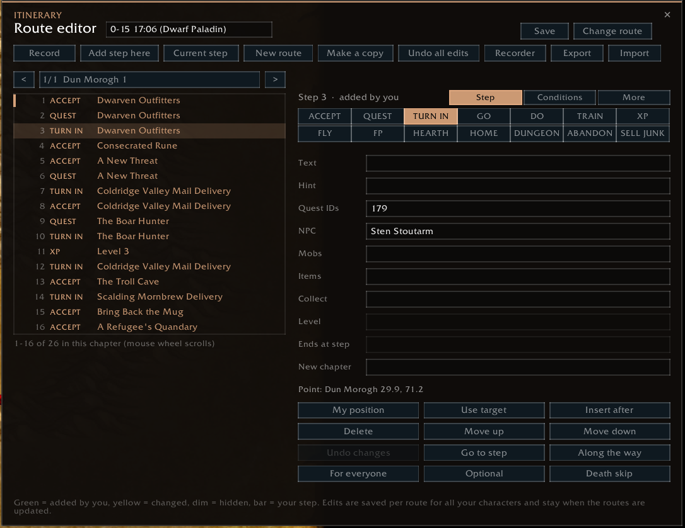

The editor changes any route, or builds one of your own: add, change, hide and move steps, and set everything
a route step can do. Open it with a **right-click on the route button** in the panel footer, or `/iti edit`.

### Your own copy
A route that comes with a route pack is never changed. Your **first edit makes your own copy** of it, and this
character goes on with the copy. The original stays in the route list. The header line says so ("edits make
your own copy"; hover it for the details). A copy is a list of your changes on top of the original route, so it
keeps working when the pack is updated.

Your changes work the moment you make them. **Save** writes them to disk right away (a quick reload, the editor
opens again). Otherwise that happens when you log out, and a game crash before that would lose them.

### The window
- **Header**: the route and its version; on a route of your own its name, which you can change right there.
  **Change route** picks the route to look at and change (this character follows it). **Save**.
- **Toolbar**:

  | Button | Does |
  |---|---|
  | **Record** | While on, every quest you accept or turn in that the route doesn't have around your step is added as a step, at your position and NPC |
  | **Add step here** | A travel step at your position, after the selected step |
  | **Current step** | Shows the step you're on |
  | **New route** | An empty route of your own; this character switches to it |
  | **Make a copy** | Your own copy of this route with your edits so far |
  | **Undo all edits** | Removes every change you made to this route (two clicks) |
  | **Recorder** | Opens the [recorder](#recording-a-route) |
  | **Export** / **Import** | [Share a route](#sharing-a-route) |

- **Step list** (left): one chapter at a time. **<** and **>** go through the chapters; click the chapter name for the
  list (*All steps* shows the whole route). Each line has the step number, its type and its text. Green = added
  by you, yellow = changed, dim = hidden, the bar = the step you're on. Scroll with the mouse wheel, click a step
  to select it.
- **Search** (over the list): type and the chapter's steps whose text has it drop down under the box, in any
  case (quest steps: the quest's name; a step with two quests shows the one it found in grey). **Click one** and
  the step list goes to that step and selects it, with a few steps above it showing, so you can work around it;
  **Enter** goes to the first. The list itself stays whole. Click into the box again for the matches; with *All
  steps* in the chapter list they come from the whole route. Escape closes the matches, **×** clears the search.
- **Step details** (right), on three pages: **Step**, **Conditions** and **More**. The tabs show how many
  things are set on the other two (*Conditions (2)*). Hover any field or button for what it does.

### The Step page
**Type** (hover one for what it does):

| Type | Text is | Done when |
|---|---|---|
| **Accept** | (the quest's name) | the quests in *Quest IDs* are in your log |
| **Quest** | (the quest's name) | the quests' objectives are done |
| **Turn in** | (the quest's name) | the quests are handed in |
| **Go** | where you go | you get to the step's point (or the zone, see *More*) |
| **Do** | what to do | you have its *Collect* items, open its NPC as a vendor, get to its point (with *More > Done in* set), or skip it |
| **Train** | | you've trained (a class trainer: nothing new is waiting) |
| **XP** | | you reach the *Level* |
| **Fly** | where to (*Menethil Harbor*) | you're in the air; talking to the flight master takes that flight for you |
| **Flight path** | the town | you learn it, or already have it |
| **Hearth** | your home inn | you cast it (or are there already); your Hearthstone gets an item button |
| **Home** | the place, as the game names your home | it's your home; the innkeeper's question is answered for you |
| **Dungeon** | its name (the step's point: the entrance) | you're inside |
| **Abandon** | *Abandon …* (set for you) | none of the quests is in your log (also: never taken, or finished and handed in later on the route) |
| **Sell junk** | | you open a vendor; it's an instruction next to the next few steps, not a stop |

A new step's placeholder text becomes what the type needs: your home for a hearth, where you stand for a flight
path or a new home, *Abandon <quest>* for an abandon step. The quests go along when you switch between a quest
type and Abandon.

**Fields**:

| Field | What goes in |
|---|---|
| **Text** | What the step says (travel and to-do steps; see the table above for the others) |
| **Hint** | A line under the step (*Fill the phial at the moonwell*) |
| **Quest IDs** | The quests, comma separated (the ID is in the quest's Wowhead link). For a Quest step, `12:2` means only objective 2 of quest 12 |
| **NPC** | Who to talk to. Several, comma separated: the first is the one to talk to, the target button looks for all. *Use target* fills it in |
| **Mobs** | Mobs for the target button, comma separated |
| **Items** | Usable items for the item buttons while the step is up: Shift-click an item from your bags |
| **Collect** | Items to have in your bags with how many: Shift-click an item, then set the count (`2886 Crag Boar Rib x6`) |
| **Level** | XP steps: the level to reach (table below). Accept steps: the level the quest needs (NEEDS LEVEL until then) |
| **Ends at step** | For an *Along the way* step: the step number where it stops showing. Empty: until it's done, the chapter ends, or a later step completes or turns in its quest |
| **New chapter** | Starts a chapter with this name at the step |

| Level: you type | Done when |
|---|---|
| `5` | you reach level 5 |
| `3 1200xp` | you're 1200 XP into level 3 |
| `3 50%` | you're halfway through level 3 |
| `4 -300xp` | you're within 300 XP of level 4 |

Under the fields: the step's **point** (*Point: Loch Modan 33.9, 51.0*, or *No point*: the arrow has nowhere
to go).

**Buttons**:

| Button | Does |
|---|---|
| **My position** | Puts the step's point where you stand; its waypoints and kill area go (*More*: **Here** on the **P** line keeps them) |
| **Use target** | Your target becomes the NPC, or is added to the mobs if it's an enemy |
| **Insert after** | A new step after the selected one, at your position |
| **Hide / Show / Delete** | Hides a step of the route (shown dimmed, *Show* brings it back), or deletes a step you added |
| **Move up / Move down** | Moves a step you added |
| **Undo changes** | The step as the route has it |
| **Go to step** | Makes it the step you're on |
| **Along the way** | The step runs alongside the following steps until it's done. A Quest step shows its objectives with live counts (a later step of the same quest takes over from there), a Do step with *Collect* its items, a Do step with only text is an instruction |
| **For everyone / Auction house / Self-found only** | Who gets the step (click to switch). *Auction house* steps are left out when Settings > Quests > *Auction house steps* is on Skip (self-found play); *Self-found only* steps show only then. Route pack steps can come marked already, and any step at an auctioneer counts as an auction house step |
| **Optional** | Shown as OPTIONAL, and passed by itself once you're done with a later quest step |
| **Death skip** | Makes the step "Die and respawn at the spirit healer": an instruction next to the steps after it, done once you're alive again. With a point, the arrow leads there first (the place to die) |

### The Conditions page
The step is only for you while **all** of these hold; it's left out otherwise. Empty: always. The conditions
the route's own steps have show here too, so you can see why a step is left out.

| Field | You type |
|---|---|
| **Quests** | `on 123` (in your log), `ready 123` (finished, not handed in), `done 123` (handed in), each also with `not`: `not done 123`. Comma separated |
| **Level** | `20+` (from 20 on), `<20` (below 20), `10-19` |
| **Zone** | `in Darkshore` (only there), `not in Stormwind City`, a subzone by its area ID: `in area 150` |
| **Item** | `5000 x3` (at least 3 of it), `<5000 x3` (fewer than 3); Shift-click an item |
| **Until buff** | An item you eat or use for its buff: the step shows while the buff is missing (Shift-click it) |
| **Profession** | `mining` (you know it), `cooking 50+`, `cooking <50` (below 50, or not learned), `cooking 10-49` |
| **Money** | `1g 50s+` (at least that much), `<50s` (less than that) |
| **Weapon** | `<10.5` (main hand DPS below 10.5), `ranged <8`, `off hand <6` |
| **Level jump** | `14 Westfall end`: the steps with this name form a section that's left out when you get to its first step above level 14 (decided once) |

### The More page

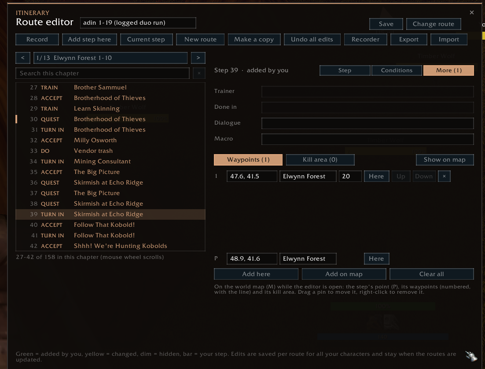

| Field | You type |
|---|---|
| **Trainer** (train steps) | `class` (your class trainer), `weapons 202, 196` (a weapon master; the skills' spell IDs), `any of 202, 196` (one is enough). Empty: another trainer (a profession, riding) |
| **Done in** (go and do steps) | A zone (`Redridge Mountains`: done once you're in it), a subzone by its area ID (`area 150`), or how close counts as there (`20 yd`; 15 when not set) |
| **Dialogue** | What to say to the NPC: `talk` (when there's just the one option), or the dialogue options' IDs |
| **Macro** | A button next to the panel that runs it while the step is up (`/sit`); lines separated by `;` |

**Waypoints and kill area** (under the fields): two lists, switched with **Waypoints** and **Kill area** (with how
many each has).
- **Waypoints**: the points the arrow leads through, in this order, before the step's point (into a cave, around
  a mountain). The last line, **P**, is the step's point itself.
- **Kill area**: the spots of the area where the step's mobs are. From two spots on, the arrow goes from one to the
  next.
- Each line: its coordinates on the zone map, its zone, for a waypoint how close counts as reached (yards; 15
  when empty), **Here** (moves it to where you stand), **Up** / **Down** (the order) and **×** (removes it).
  Scroll with the mouse wheel when there are more.
- **Coordinates**: type new ones (`42.1, 65.3`), with a zone if it's on another map (`Westfall 56.3, 47.5`), or
  paste a `/way` line (`/way Westfall 56.3 47.5 Sentinel Hill`).
- **Zone**: type another one and the coordinates go on that map: its name in any case (`Westfall`), the start of
  it (`elwynn`, `stormwind`) or its map ID (`map 1436`). When more than one zone fits, the chat lists them.
- A step **without a point** shows "no point yet" on the P line: type its coordinates there (in the zone you're
  in unless you type one), press **Here**, or click it in with **Add on map**.
- **Add here**: where you stand, at the end of the list (a step without a point gets its point first).
- **Add on map**: opens the world map; every click on it adds one there. Right-click on the map (or the button
  again) stops.
- **Clear all**: removes all waypoints, or all spots (two clicks).
- **Show on map**: opens the world map at the step.

**On the world map** while the editor is open, the selected step is drawn instead of your next stops: its point
(**P**), its waypoints (numbered, with a dotted line through them to the point) and its kill-area spots.
**Drag a pin** to move it, **right-click** a waypoint or spot to remove it. Close the editor and the map shows your
next stops again.

### How do I …
- **Add a quest the route doesn't have**: switch on **Record** and take it; it's added at your position with
  the NPC. Or **Insert after**, type **Accept**, the quest's ID, **Use target** on the NPC.
- **Leave a step out**: **Hide**. Only for some characters: a condition (*Conditions*), or *Self-found only* /
  *Auction house*.
- **Add a flight, a flight path, a hearth**: **Insert after** at the flight master or innkeeper, pick the type,
  check the Text.
- **Have something shown while you do the next steps**: a Do step with the text, **Along the way**, and
  **Ends at step**.
- **Add a death skip**: stand where to die, **Insert after**, **Death skip**.
- **Guide the arrow through a cave**: select the step, walk the way and press **Add here** at each turn
  (*More*, Waypoints). Or click them in with **Add on map**, and drag them into place.
- **Share it**: **Export** (your own copy), see [Sharing a route](#sharing-a-route).

### Recording a route

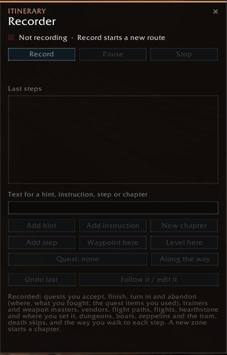

The recorder writes a new route of its own while you play. Open it: Shift + right-click the route button,
`/iti recorder`, or the *Recorder* button in the editor. Press **Record** and play. From then on, these become
steps on their own:
- **Quests** you accept, finish and turn in: where you were, what you fought and the kill-area spots. A quest
  item you used for it goes on the quest's item button, an **emote** you did right before an objective moved
  (*/sit* at the campfire, */salute* at a guard) on a macro button. A quest you **abandon** becomes an abandon
  step.
- **Trainers**: your class trainer, profession trainers, and a **weapon master** you learned a weapon skill at
  (a train step for that skill).
- **Vendors**: food, drink and bags you buy are an errand at that vendor (an instruction you can click);
  anything else you buy is a step that's done once you have it (*Buy Rough Arrow*, with Collect). Only sold or
  repaired: *Vendor trash* / *Repair* there. Gathering tools aren't recorded: Itinerary buys those for you.
- **Flight paths, flights**, your **hearthstone** and where you set it.
- **Dungeons**: a dungeon step at the entrance. Quests you finish inside get their step too (the game doesn't
  tell where you are in there: the arrow leads to the entrance).
- **Boats and zeppelins** to the other continent: *Take the boat to Menethil Harbor* at the dock you waited at,
  done once you're there. The **Deeprun Tram** the same way.
- **Death skips**: coming back at the spirit healer far from where you died is a death skip there (a run back to
  your corpse isn't). Chat tells you; *Undo last* if you didn't mean one.
- **The way you walk**: each step gets the corners of the way you walked to it as its waypoints, when the way
  wasn't about straight (at most 8; a detour out and back to a herb or a mob is left out). Change them on the
  editor's *More* page.

A new zone starts a new chapter (not inside a dungeon). A boat within one continent (Auberdine – Rut'theran
Village) isn't recorded: press *Waypoint here* at the dock.

While recording, the panel footer shows a red **REC**. *Pause* stops recording for a while. *Stop* (two
clicks) ends it, and the route stays in your route list. Change it afterwards in the editor.

Type into the recorder's text box and add your own:

| Button | Becomes |
|---|---|
| **Add hint** | A hint under the last recorded step |
| **Add instruction** | An instruction from here to the end of the chapter, or until the picked quest is turned in |
| **Along the way** | The picked quest's objectives as a side objective from here on, with live counts |
| **Add step** | A to-do step at your position |
| **Waypoint here** | A travel step to where you stand |
| **Level here** | A step that's done at your level and XP right now (*11 2300xp*), at your position: press it when you're done grinding |
| **New chapter** | The next step starts a chapter with this name |
| **Undo last** | Removes the last recorded step |

The **Quest** button picks a quest from your log (click: next, Shift-click: back). *Add instruction* and
*Along the way* use it.

---

## 10. Settings

Open them with the gear in the panel footer, Shift + click on the minimap button, or `/iti settings`.

| Tab | What's there |
|---|---|
| General | Route panel and minimap button, hide them in dungeons, the game's quest tracker, the sound when a step is done, route pack order and the packs' own choices, factory reset, forget this character |
| Quests | Accept and hand in, which quests (route or all), share quests in a group, quest dialogue, object name tags, quest sparkles, pick gear rewards, best-selling reward coin, sell junk, auction house steps |
| Travel | Take flights, set hearthstone, spirit healer, map pins (on the world map, on the minimap, the line between them) |
| Trainer | Buy class skills (only worthwhile ones), open the training window, trainer visits (instruction or step), weapon skills, buy weapon skills, your class's skill list (worth a visit / auto-buy) |
| Professions | Learn at the trainer, main professions, first profession, secondary professions, gather mode, gather data (shipped, own, both), gathering tracking, node icons, gathering tools |
| Panel | Color scheme (Itinerary, Amethyst, Frost, Ember, Slate), instructions (own card or in the panel), item and spell links, panel style (card or minimal), opacity, size, text on a see-through panel (shadow or outline), grow direction, item & target button corner, lock |
| Arrow | Arrow on/off, arrow look, instructions at the arrow, death skips at the arrow, their size, tooltip, lock |
| Keys | Key bindings for the target and item buttons; show the target button, talk on second press, tag with a spell, mark the target |

<b>Screenshots of every settings tab</b> (click to open)

| General | Quests |
|---|---|
| 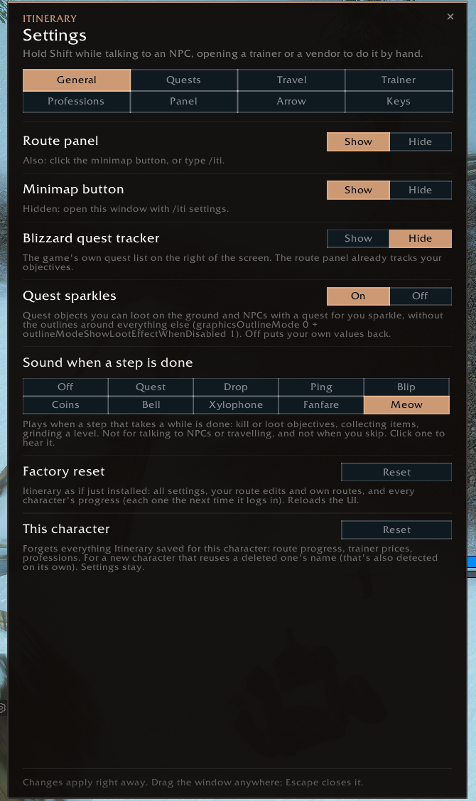 | 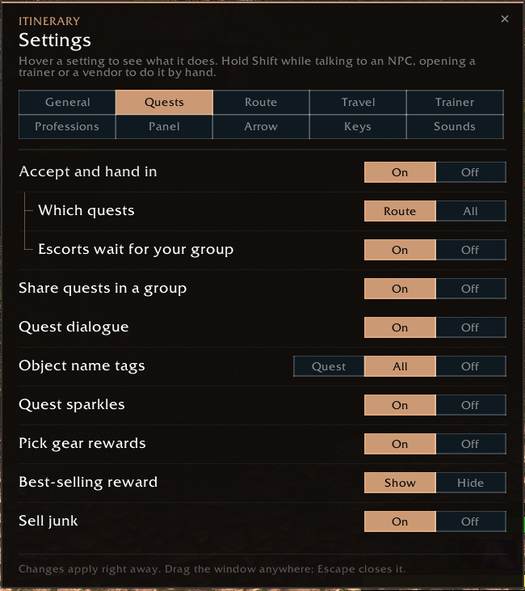 |
| **Travel** | **Trainer** |
| 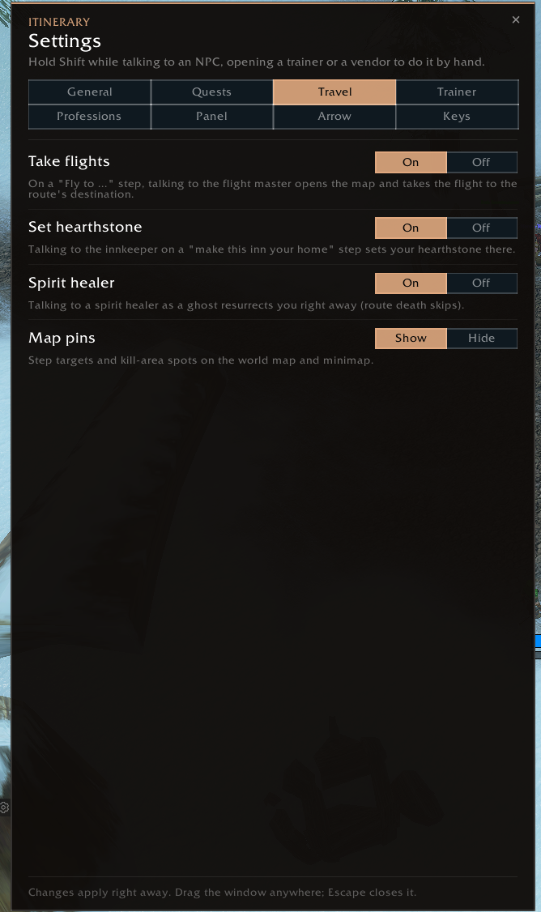 | 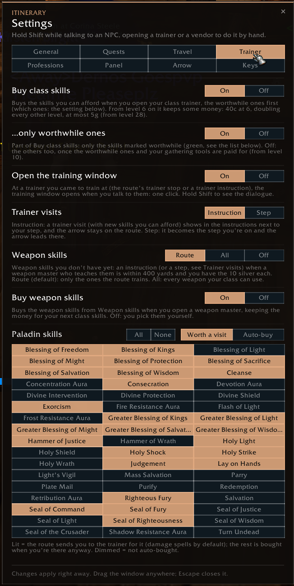 |
| **Professions** | **Panel** |
| 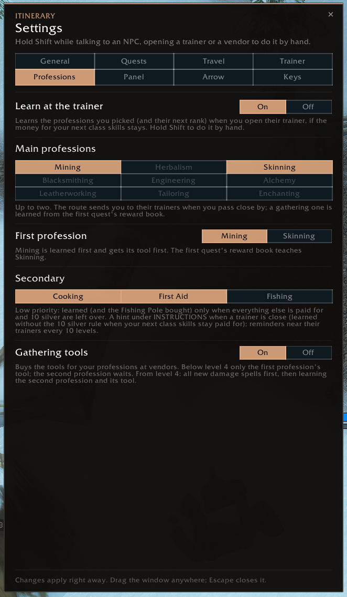 | 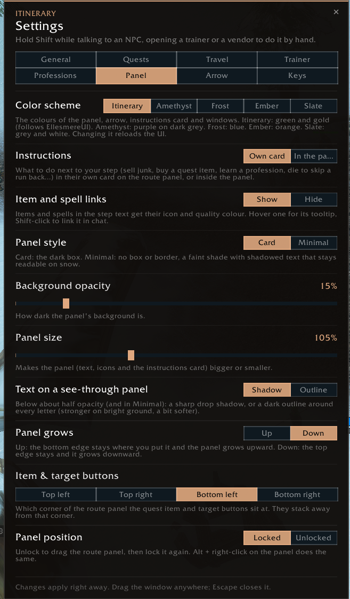 |
| **Arrow** | **Keys** |
| 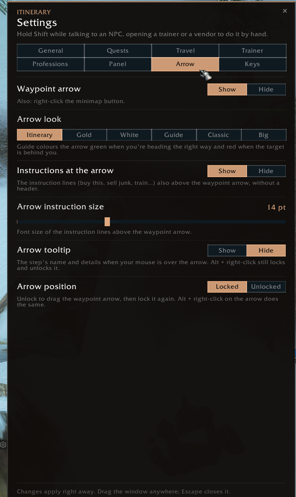 | 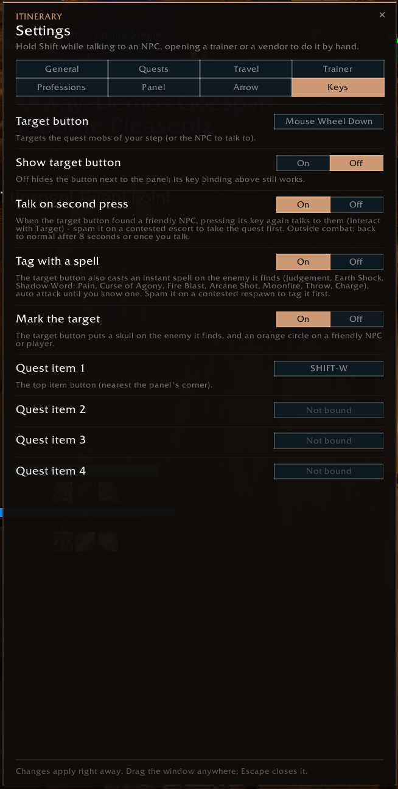 |

---

## 11. Commands

| Command | Does |
|---|---|
| `/iti` | Show or hide the route panel |
| `/iti settings` | Settings |
| `/iti next` / `/iti back` | One step forward / back |
| `/iti goto <n>` | Jump to step n |
| `/iti find` | Go to the first step you haven't done |
| `/iti chapters`, `/iti chapter <n>` | Chapter list / jump to chapter n |
| `/iti routes`, `/iti routes all`, `/iti route <id>` | List routes / all routes / switch |
| `/iti edit` | Route editor |
| `/iti recorder` | Recorder |
| `/iti record` | Editor's quick record: quests you take that the route doesn't have are added to it |
| `/iti export`, `/iti import` | Share a route |
| `/iti professions` | Profession picker |
| `/iti gather` | Gather mode on/off |
| `/iti arrow`, `/iti pins`, `/iti minimap` | Toggle the arrow, map pins, minimap button |
| `/iti lock`, `/iti unlock` | Lock or unlock panel and arrow |
| `/iti reset` | Start this route over from its first unfinished step |
| `/iti wipe yes` | Forget everything saved for this character (settings stay) |
| `/iti factoryreset yes` | Itinerary as if just installed (all settings, routes and progress) |
| `/iti debug` | Details about the current step, trainers and weapons (for bug reports) |
| `/iti target` | What the target button looks for and which nameplate it picks |
| `/iti track` | What gathering tracking sees and did lately |
| `/iti tags` | The object the game picks in front of you and why it gets a name tag or not |

---

## 12. Troubleshooting

- **The panel says "No route loaded".** You have no route for this character yet. Record one, import
  one, or install a route pack. If you were on a route from a pack that's no longer installed, your place
  on it is kept. Install the pack again and you continue where you were.
- **The route jumped ahead or seems wrong.** `/iti find` goes back to the first step you haven't done.
  `/iti back` undoes a skip.
- **"The routes were updated - picked up again at step …"**: a route pack update moved the steps; Itinerary
  found the step you were on. Check the step and use `/iti find` if it's off.
- **A quest step doesn't tick off.** Quests the giver doesn't offer you (a missing pre-quest, too low
  level) are skipped after a moment. `/iti debug` shows what the game reports for the step's quests.
- **No trainer instruction.** The trainer must be within 400 yards, and you need the money for a
  worthwhile skill on top of the reserve. `/iti debug` shows money, what's waiting and the trainers
  close by.
- **Something looks broken.** Type `/console scriptErrors 1`, then `/reload`. Send the error message
  together with the `/iti debug` output.

---

## 13. Credits and license

Itinerary is made by **Ghaan**. All rights reserved: you may install it, use it and read its code, but not
pass it on or reuse its parts elsewhere - see `LICENSE.txt` in the add-on folder.

- **Libraries** (each under its own license, listed in `LICENSE.txt`): LibStub, CallbackHandler-1.0,
  LibDataBroker-1.1, LibDBIcon-1.0, HereBeDragons, LibDeflate and LibSerialize.
- **Sounds**: *Bell*, *Blip*, *Drop* and *Meow* are by Mike Koenig, Marianne Gagnon and Cat Stevens from
  SoundBible.com, under Creative Commons Attribution 3.0 (`sounds/CREDITS.txt`). *Coins*, *Sonar*, *Xylophone*
  and *Fanfare* were made for Itinerary.
- **Itinerary_Data** comes in the same download but is a separate add-on under the GNU GPL v3; its positions
  come from the WoW Forever data of QuestieDB and from what Itinerary players found in game.
- **Routes** come separately (route packs, shared texts, your own recordings), each with its own terms.

World of Warcraft is a trademark of Blizzard Entertainment. Itinerary is not affiliated with or endorsed by
Blizzard Entertainment.
